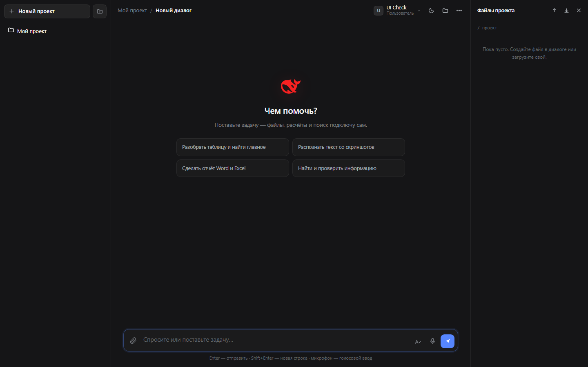
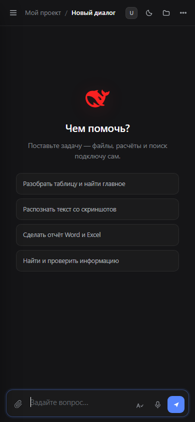
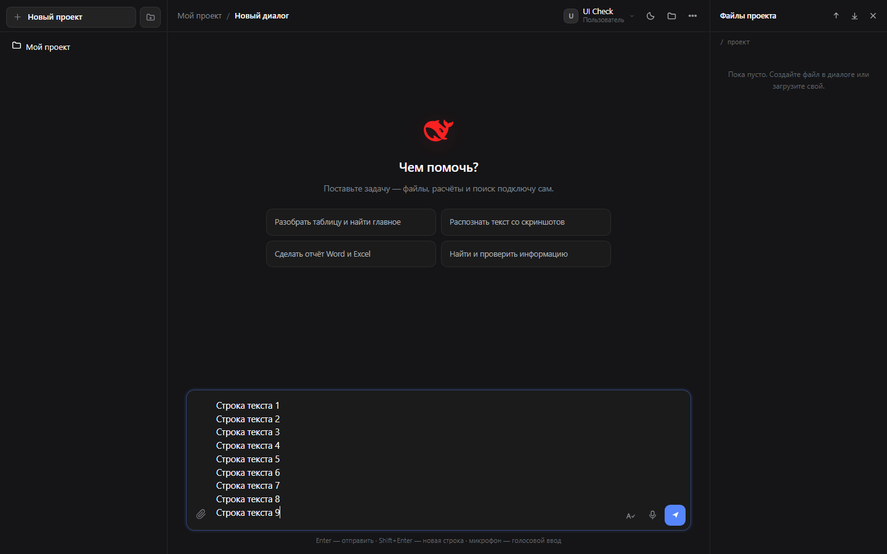

# AIOpen — окно чата с ИИ, которое живёт у вас

Веб-сервис в стиле рабочего окна Harness: диалоги с моделью, проекты, файлы, распознавание
документов и скриншотов, голосовой ввод, проверка орфографии, создание Word/Excel, поиск
в интернете. Один процесс Node.js без зависимостей, без сборки фронтенда, без CDN.

**Живой сервис:** <https://dshopen-vladimir00177.msk1.amvera.tech>



| Телефон | Длинный ввод |
| --- | --- |
|  |  |

## Что умеет

- Потоковый ответ модели, остановка генерации, заголовок диалога по содержанию.
- Проекты и диалоги внутри них; у каждого проекта свой рабочий каталог. Новый проект
  создаётся одной кнопкой, диалог — плюсом в строке проекта. Папки проектов, созданные
  раньше, остаются: их можно переименовать, удалить и перемещать в них проекты, но новых
  папок интерфейс больше не создаёт — чтобы не путать папку с проектом.
- Вложения: Word, Excel, PowerPoint, PDF, RTF, текстовые, таблицы, изображения.
  Текст документов извлекается, картинки распознаются, результат попадает в ответ.
- Голосовой ввод: запись с микрофона, распознавание речи на сервере.
- «Aa» — проверка орфографии и пунктуации набранного текста.
- Видно, что ассистент работает: в шапке ответа крутится индикатор и подпись «работаю…».
  Однотипные шаги агента («Расчёты» ×4, «Создание Excel» ×2) собраны в одну строку со
  счётчиком — подробности раскрываются щелчком, лента не превращается в простыню.
- Панели «Проекты» и «Файлы проекта» одной ширины — по 280 px, каждая тянется за свой
  край; пока правую не трогали, она повторяет ширину левой, двойной щелчок возвращает
  это равенство. Выбранная ширина запоминается в браузере. В шапке диалога — только его
  название; меню, переименование и подтверждения открываются карточками внутри той
  панели, из которой их вызвали, с одинаковыми отступами от её краёв. Меню учётной
  записи прижато к правой границе шапки, а не к самой кнопке.
- Файлы проекта: создание, правка, скачивание, удаление, экспорт проекта в ZIP.
  Файлы с компьютера можно просто перетащить в панель «Файлы проекта» — они сохранятся
  в открытую папку проекта; а файл из панели можно вытащить мышью на рабочий стол или
  в любую папку (Chrome и Edge скачивают файл, остальные браузеры отдают ссылку на него).
- Кнопка «Скачать» в строке один раз сохраняет оригинал в «Загрузки»: дальше его открывает
  система программой по умолчанию для этого типа файлов. Одиночный клик по строке файла на
  компьютере ничего не скачивает, и всплывающих подсказок при скачивании нет: сообщения о
  файлах идут спокойной строкой в самой панели, а общие уведомления — плашкой под шапкой,
  а не поверх поля ввода (раньше плашка вылетала внизу и закрывала набранный текст).
- Двойной щелчок по документу на компьютере открывает его в том же окне просмотра, что
  и тап на телефоне. Внешние Word, Excel и PowerPoint сервис не вызывает ни на одном
  устройстве: документ уходил в них по протоколу `ms-word` / `ms-excel` / `ms-powerpoint`,
  программа сама скачивала файл из интернета, и Office показывал системное окно «Microsoft
  Office» с вопросом «Открыть этот файл?». Убрать это окно со стороны сервера нельзя: метку
  «файл из интернета» (Mark-of-the-Web, поток `Zone.Identifier`) ставит сама Windows в момент
  скачивания, и никакой заголовок ответа её не отменяет. Поэтому документ читается в окне
  просмотра сервиса, а для правки остаётся кнопка «Скачать»; в окне просмотра об этом есть
  спокойная подсказка сверху документа.
- Тап или щелчок по файлу открывает окно просмотра внутри приложения: Word читается
  заголовками, абзацами с жирным и курсивом, списками и таблицами; Excel — листами с
  переключением и числами по правому краю; PowerPoint — карточками слайдов; CSV, Markdown,
  JSON и код — своей разметкой; PDF — прежним постраничным просмотром, картинки — как
  изображение. У окна есть «Скачать» и «Закрыть», а закрытие возвращает к панели
  «Файлы проекта», из которой файл открыли.
- Файл никогда не уходит во внешнюю программу — ни на телефоне, ни на компьютере:
  системная страница «Открыть в…» уводила бы из приложения без пути назад.
- HTML-страницы показываются как настоящая страница в изолированном фрейме: своя вёрстка,
  шрифты и стили, но без доступа к сессии сервиса. Картинки и ссылки этой страницы идут
  по коротким подписанным ссылкам (`/o/…`), поэтому cookie браузера ей не нужны.
- Создание документов на уровне офисных скилов харнесса: Excel (`create_excel`), Word
  (`create_word`), презентации (`create_pptx`), PDF (`create_pdf`).
  - Word: обложка, оглавление, KPI-строка, разделы и подразделы, таблицы с итоговой
    строкой и числовым выравниванием, колонтитул с «стр. N из M», картинки из файлов
    проекта (PNG/JPEG/GIF/BMP с подписями) и настоящие диаграммы Word (столбцы, бары,
    линии, круги, площади) со встроенной книгой данных — в Word работают «Изменить данные»
    и смена типа диаграммы.
  - Excel: шапка с форматами чисел, реальные формулы (`=SUM(...)`, `=C2/B2-1`), итоговая
    строка, цветовая шкала, автофильтр, закреплённые строки и настоящие диаграммы
    (столбцы, бары, линии, круги) отдельной частью OOXML.
  - PowerPoint: 16:9, обложка, разделители, слайды с тезисами, диаграммы, таблицы,
    KPI-плашки и заметки докладчика.
  - PDF: документ A4 (pdfkit, встроенные шрифты с кириллицей — текст выделяется и ищется)
    или презентация 16:9 по слайдам.
  - Если библиотека недоступна, инструмент молча откатывается на прежний сборщик —
    сервис не падает, файл всё равно появляется.
- Запуск Python (`run_python`), если он есть в окружении.
- Анализ данных (`analyze_data`): профиль файла, фильтры, группировки (в том числе по
  году/кварталу/месяцу/неделе/дню), метрики (сумма, среднее, медиана, p95, стандартное
  отклонение, число уникальных), сортировка и лимит — одним вызовом. CSV читается потоком
  с автоопределением разделителя и кодировки (UTF-8/win1251), XLSX — по листам; сотни
  тысяч строк считаются без загрузки файла в контекст модели. Там, где раньше `read_file`
  показывал «файл слишком большой», модель сразу получает готовые числа.
- Навыки из папки `skills`: каждый навык — папка с `SKILL.md` (frontmatter `name`,
  `description`, `when`). В подсказке модели всегда виден каталог навыков, а тело нужного
  навыка модель читает инструментом `use_skill` — без перезапуска сервиса и без правки кода.
- Память о человеке: сказанное в одном диалоге переносится в следующие. Модель сохраняет
  факт инструментом `remember` (одинаковые и близкие формулировки заменяются, а не
  дублируются), а в шапке каждого ответа эти факты попадают в системную подсказку.
  В меню учётной записи есть «Что сервис помнит»: список фактов, удаление по одному и
  «Очистить всё» — модель сразу перестаёт это учитывать.
- Проверка готовых файлов: после каждого `create_word` / `create_excel` / `create_pptx` /
  `create_pdf` сервис разбирает получившийся OOXML или PDF и возвращает модели отчёт
  «Проверка файла: OK (…)» либо список ошибок и замечаний (пустые слайды, битые связи,
  ячейки без данных, файл без `%%EOF`, диаграмма без книги данных и т. п.). Инструмент
  `check_document` делает то же для любого файла проекта по запросу.
- Поиск в интернете и чтение страниц без ключей сторонних API.
- Светлая и тёмная темы. На телефоне обе панели выезжают одинаковыми блоками с
  затемнением: «Проекты» слева, «Файлы проекта» справа; у файлов в заголовке есть
  крестик для закрытия. До 1100 px файлы тоже открываются ящиком с крестиком.
- Ключи моделей живут только на сервере; в браузер и в ответы API они не попадают.
- Баланс в долларах в шапке: задачи списываются с него сами, администратор пополняет.

## Быстрый старт

Нужен Node.js 20+ (проверено на 22 и 26). Больше ничего устанавливать не требуется.

```powershell
git clone https://github.com/akkountmy/aiopen.git
cd aiopen
$env:DSHOW_DEEPSEEK_KEY = 'ваш-ключ-модели'
node server.mjs
```

Открыть <http://127.0.0.1:3123>. Первый вход — администратор `DSHOPENWEB` с паролем
из `DSHOW_ADMIN_PASSWORD` (если переменная не задана, пароль генерируется при первом
запуске и печатается в консоль один раз). Дальше администратор создаёт учётные записи:
меню пользователя → «Пользователи». Каждый видит только свои проекты и диалоги.

Если сервис должен быть открыт для всех, запустите с `DSHOW_OPEN_SIGNUP=1` — на экране
входа появится «Создать» и любой посетитель заведёт себе аккаунт сам (не больше
`DSHOW_SIGNUP_PER_HOUR` аккаунтов с одного IP в час). По умолчанию регистрация закрыта.

На Windows удобны `start.cmd` (с окном консоли) и `start-hidden.vbs` (без окна, лог в
`data\server.log`), остановка — `stop.cmd`.

## Переменные окружения

| Переменная | Назначение | По умолчанию |
| --- | --- | --- |
| `DSHOW_PORT` | порт HTTP | `3123` |
| `DSHOW_HOST` | адрес привязки | `127.0.0.1` |
| `DSHOW_DATA_DIR` | каталог состояния и проектов | `./data` |
| `DSHOW_ADMIN_PASSWORD` | пароль администратора при первом создании | генерируется |
| `DSHOW_DEEPSEEK_KEY` | ключ модели (только на сервере) | — |
| `OPENROUTER_API_KEY` | распознавание изображений | — |
| `DSHOW_TRUST_PROXY` | брать IP из `X-Forwarded-For` (за HTTPS-прокси) | `0` |
| `DSHOW_OPEN_SIGNUP` | свободная регистрация на экране входа (`1` — включить) | `0` |
| `DSHOW_SIGNUP_PER_HOUR` | сколько аккаунтов может создать один IP за час | `3` |
| `DSHOW_SESSIONS_MAX` | одновременных устройств на аккаунт (ноутбук + телефон + ярлык) | `3` |
| `DSHOW_MAX_ATTACHMENT_MB` | предел размера вложения | `64` |
| `DSHOW_MAX_PARSE_MB` | предел разбора документа | `24` |
| `DSHOW_MIN_FREE_MB` | минимальный запас места на диске | `256` |
| `DSHOW_HISTORY_TOKENS` | бюджет истории диалога | `60000` |
| `DSHOW_KEEP_RECENT` | сколько последних сообщений не сжимать | `10` |
| `DSHOW_MAX_STEPS` | шагов в одном отрезке длинной задачи | `40` |
| `DSHOW_MAX_SEGMENTS` | сколько отрезков подряд (потолок = произведение) | `12` |
| `DSHOW_TASK_LIMIT_USD` | порог стоимости одной задачи, $ | `10` |
| `DSHOW_TASK_STEP_USD` | насколько поднимает порог одобрение администратора, $ | `10` |
| `DSHOW_START_CREDIT_USD` | стартовый баланс новой учётной записи, $ | `20` |
| `DSHOW_PUBLIC_URL` | публичный адрес сервиса для ссылок на файлы; по умолчанию берётся из запроса | — |

## Развёртывание в облаке

В репозитории есть `amvera.yaml` (Node.js, запуск `server.mjs`, порт `3123`, постоянный
диск `/data`). Подойдёт любой хостинг, умеющий «Node + постоянный диск»:

```yaml
DSHOW_HOST: 0.0.0.0
DSHOW_PORT: 3123
DSHOW_DATA_DIR: /data
DSHOW_TRUST_PROXY: 1
```

Секреты (`DSHOW_ADMIN_PASSWORD`, `DSHOW_DEEPSEEK_KEY`, `OPENROUTER_API_KEY`) задаются
в настройках проекта, а не в репозитории. `DSHOW_TRUST_PROXY=1` нужен, чтобы ограничение
попыток входа считалось по реальному IP, а не по адресу прокси.

### Сторож доступности

`scripts/watchdog.mjs` раз в час проверяет облачный `/api/health` (две попытки с
интервалом 25 с, чтобы разовый сбой сети не будил человека) и пишет в Telegram только
при аварии и при восстановлении. Адрес задаётся `DSH_WATCHDOG_URL`, журнал —
`dshow-watchdog.log` рядом с настройками бота. В этом окружении его запускает задача
планировщика `DSH OPEN WEB Watchdog` через `dshow-watchdog-hide.vbs`, поэтому окно
консоли не появляется. Сторож живёт на машине, с которой его поставили: если она
выключена, проверок нет — но сервис от этого не зависит.

### Сторож места

`scripts/storage-watch.mjs` раз в неделю спрашивает у облачного сервиса
`/api/admin/storage` (только для администратора), сколько занято на диске тарифа, и
пишет в Telegram, когда занято больше **70%** (`DSHOW_STORAGE_ALERT_PCT`). Пока место
в норме, сторож молчит; когда опускается ниже порога — сообщает об этом. Повторное
напоминание при постоянно заполненном диске приходит не чаще раза в четыре недели
(`DSHOW_STORAGE_REMIND_DAYS`). Журнал — `dshow-storage.log`, состояние —
`dshow-storage-state.json`, пароль администратора обёртка `scripts/storage-watch.ps1`
берёт из хранилища и в журнал не пишет. Запускает задачу планировщик
`DSH OPEN WEB Storage Watch` (понедельник, 10:00) через `dshow-storage-hide.vbs`.

Потолок берётся не из `statfs`: в облаке `/data` лежит на общем диске узла (терабайты
вместе с соседними проектами), а отдельного запроса «сколько дали» у платформы нет.
Зато ОЗУ и SSD в тарифах Amvera идут парами (100 МБ → 2 ГБ, 500 МБ → 5 ГБ, 1 ГБ → 7 ГБ,
2,5 ГБ → 15 ГБ, 6 ГБ → 25 ГБ, 9 ГБ → 35 ГБ), поэтому сервис определяет тариф по лимиту
памяти контейнера из cgroup. Точную цифру можно задать вручную — `DSHOW_STORAGE_CAP_MB`.

## Устройство

```
server.mjs          HTTP-сервер: вход, проекты, диалоги, файлы, поток ответа
src/config.mjs      настройки, лимиты, уровень контекста
src/store.mjs       пользователи, проекты, диалоги, вложения (data/index.json)
src/agent.mjs       цикл ответа: история, инструменты, потоковая выдача
src/tools.mjs       инструменты проекта и защита путей
src/doc/index.mjs   выбор движка документа и откат на прежние сборщики
src/doc/docx.mjs    Word: обложка, разделы, KPI, таблицы, колонтитулы (docx)
src/doc/docx-chart.mjs  диаграммы Word: части OOXML, книга данных, вставка объекта (jszip)
src/doc/image-info.mjs  формат и размер картинки по сигнатуре файла
src/doc/xlsx.mjs    Excel: шапка, форматы, формулы, итоги, диаграммы (exceljs)
src/doc/xlsx-chart.mjs  вставка диаграмм OOXML в готовый файл (jszip)
src/doc/pptx.mjs    презентации 16:9: обложка, слайды, диаграммы, заметки (pptxgenjs)
src/doc/pdf.mjs     PDF на pdfkit: документ A4 и презентация 16:9
src/doc/theme.mjs   палитра, шрифты, форматы чисел и типографика документов
src/docparse.mjs    разбор docx/xlsx/pptx/pdf/rtf/html/text
src/docpreview.mjs  модель документа для окна просмотра: блоки Word, листы Excel, слайды, таблицы CSV
src/openlink.mjs    короткие подписанные ссылки на файл для Office и для HTML-страниц
src/vision.mjs      распознавание изображений
src/asr.mjs         распознавание речи
src/proofread.mjs   проверка орфографии и пунктуации
src/search.mjs      поиск и загрузка страниц
src/prompt.mjs      системные инструкции
src/memory.mjs      память о человеке: формулировки фактов и текст подсказки
src/skills.mjs      каталог навыков skills/*/SKILL.md и чтение тела навыка
src/doccheck.mjs    структурная проверка docx/xlsx/pptx/pdf после создания
skills/             навыки: папка на навык, внутри SKILL.md
public/             интерфейс (HTML/CSS/JS без сборки)
public/theme.js     применение темы до первой отрисовки
data/               состояние сервиса, рабочие каталоги проектов
test/               проверки API, контекста, лендинга, распознавания
scripts/            служебные скрипты развёртывания
```

Фронтенд — три файла: `index.html`, `styles.css`, `app.js`. Никаких сборщиков и фреймворков.
Статика отдаётся сжатой (gzip) и с `immutable`-кэшем по версии файла, поэтому повторные
загрузки почти бесплатны.

## Контекст диалога

История не растёт бесконечно: когда она переполняет бюджет, старые реплики вырезаются,
а их краткий конспект пишется в файл чата и подставляется в следующий запрос.

| Параметр | Значение | Переменная |
| --- | --- | --- |
| Бюджет истории | 60 000 токенов | `DSHOW_HISTORY_TOKENS` |
| Что остаётся | последние 10 сообщений, граница — реплика пользователя | `DSHOW_KEEP_RECENT` |
| Конспект вырезанного | до 600 токенов, хранится до 2 200 символов | — |
| Результат инструмента | обрезается до 12 000 символов | — |
| Шагов в отрезке / отрезков | 40 / 12 (всего до 480 шагов) | `DSHOW_MAX_STEPS` / `DSHOW_MAX_SEGMENTS` |
| Вывод за шаг | 16 000 токенов | — |

История обрезается не только в начале хода, но и между шагами длинной задачи: иначе
большой проект упирался бы в окно модели. Сообщение с самой задачей при обрезке
закрепляется и остаётся в контексте всегда.

Память диалога привязана к диалогу: новый диалог начинается с чистого контекста
(отдельно есть память о человеке — см. раздел ниже). Транскрипт интерфейса не
обрезается — диалог читается целиком.

## Принесённые файлы

Файл, который человек загрузил или перетащил в проект, — это и есть тема разговора,
а не «вложение для сведения». Поэтому на каждом ходу сервис сам собирает сводку по
рабочей папке (`src/filebrief.mjs`) и ставит её в конец системной подсказки:

- последние 40 файлов по времени изменения: путь, тип, размер и когда появился
  («только что», «12 мин назад», «вчера 09:30», «11.10.2026»);
- у свежих файлов (изменён за последние 6 часов) — короткий пересказ содержимого:
  фрагмент текста из Word, PDF, RTF и простых текстов, листы и заголовки Excel,
  число слайдов PowerPoint, состав архива, размеры картинки в пикселях;
- разбор кешируется по «путь + размер + время изменения», поэтому повторные ходы
  не перечитывают те же документы; на сводку отведён бюджет по символам и байтам;
- вложения текущего сообщения не дублируются — их текст уже целиком в сообщении.

Дальше правило простое: если задача в сообщении есть — она выполняется сразу по
содержимому файла, без «файл получен, что с ним сделать?». Если задачи нет (человек
только принёс файл), ответ короткий: что это за файл — и **ровно три** пронумерованных
варианта работы, подобранных под тип и содержимое (договор — разобрать по рискам,
переделать формат, подготовить ответ; таблица — разобрать цифры, пересчитать и
почистить, собрать отчёт; скан — распознать в текст, вставить в документ, превратить
в таблицу; и так далее). Повторно один и тот же набор вариантов не предлагается.

## Навыки и память

**Навыки.** Каталог `skills` — это обычные папки, по одной на навык, внутри `SKILL.md`
с коротким frontmatter (`name`, `description`, `when`) и телом инструкции. В подсказке
модели всегда виден только каталог (`use_skill` — как вызвать), а полное тело навыка
модель запрашивает инструментом `use_skill`. Поэтому навык можно добавить или поправить
на работающем сервисе: файл читается с диска при каждом обращении, перезапуск не нужен.
В комплекте — `office-docx`, `office-xlsx`, `office-pptx`, `pdf-report`, `three-js`,
`web-page`, а также рабочие навыки: `data-analysis` (анализ больших выгрузок),
`fin-audit` (аудит финансов организации), `business-plan` (бизнес-план и финмодель),
`web-research` (ресёрч интернета и разбор найденного); локальная three.js лежит в
`public/vendor/three.global.js`.

Те же навыки добавляются в локальный Harness: достаточно скопировать папку навыка в
`~/.dsh/skills/<id>/`. Там у frontmatter-поля `name` есть жёсткое правило — латиница,
цифры и дефис (`data-analysis`), иначе навык молча не попадает в каталог модели; в
сервисе `name` — просто заголовок для человека и может быть русским.

**Память о человеке.** Факты хранятся в записи пользователя (`data/index.json`), отдельно
от конспекта диалога, и попадают в системную подсказку при каждом запросе. Модель
сохраняет факт инструментом `remember`; повтор той же формулировки отвечает «уже
записано», близкая по словам (совпадение ≥ 0.6) заменяет прежнюю, список ограничен
40 фактами по 400 символов. Пользователь видит и правит это в меню учётной записи →
«Что сервис помнит» (удалить один факт или очистить всё).

| Что | Где |
| --- | --- |
| Список фактов | `GET /api/memory` → `{ facts: [{ id, text, createdAt }] }` |
| Добавить факт | `POST /api/memory` `{ text }` |
| Удалить один / все | `DELETE /api/memory` `{ id }` / `{}` |

## Дорогие задачи

Порог считается по стоимости **одной задачи**, а не по накопленному расходу проекта:
мелкие задачи идут молча, сколько бы их ни было. Когда задача перевалила порог, работа
останавливается, пользователь видит предупреждение, а администратору в Telegram уходит
запрос на подтверждение.

| Параметр | По умолчанию | Переменная |
| --- | --- | --- |
| Порог одной задачи | $10 | `DSHOW_TASK_LIMIT_USD` |
| Насколько поднимает порог одобрение | +$10 | `DSHOW_TASK_STEP_USD` |

Одобрение администратора может только поднять порог. Крошечные значения, оставшиеся в
старых проектах, порог не снижают — иначе дешёвая задача упиралась бы в «лимит $0.00».

## Длинные задачи

У задачи нет «предела шагов», после которого человеку предлагают уточнить, что
продолжить. Работа идёт отрезками по `DSHOW_MAX_STEPS` шагов: когда отрезок
закончился, агент сам получает «продолжай» и ведёт задачу дальше — в ленте это
выглядит как обычное «работаю…», никаких лишних сообщений. Всего отрезков
`DSHOW_MAX_SEGMENTS`, то есть технический потолок — их произведение (по умолчанию
40 × 12 = 480 шагов). Если потолок всё-таки исчерпан (обычно это зацикливание),
ассистент подводит короткий итог вместо просьбы «уточните, что продолжить».

| Параметр | По умолчанию | Переменная |
| --- | --- | --- |
| Шагов в одном отрезке | 40 | `DSHOW_MAX_STEPS` |
| Сколько отрезков подряд | 12 | `DSHOW_MAX_SEGMENTS` |
| История диалога, токенов | 60000 | `DSHOW_HISTORY_TOKENS` |

История обрезается между шагами, а не только в начале задачи: большой проект не
упирается в окно модели. Сообщение с самой задачей при обрезке сохраняется, поэтому
агент всегда видит, что от него требуется.

## Баланс и начисления

Учётные записи пользователей работают по предоплате: в шапке рядом с именем виден баланс
в долларах. Каждая задача списывает с баланса свою стоимость — её считает сервер по
фактическому расходу токенов.

| Что | Как | Переменная |
| --- | --- | --- |
| Стартовый баланс новой учётной записи | задаётся при создании пользователя | `DSHOW_START_CREDIT_USD` |
| Пополнение и списание | «Пользователи» → «Начислить» (минус — списать) | — |
| Нулевой баланс | новые сообщения блокируются с подсказкой написать администратору | — |
| Баланс администратора | не расходуется, счётчика в шапке нет | — |

Окно «Пользователи» администратор открывает из меню своей учётной записи. Поле «Баланс, $»
в форме создания можно оставить пустым — тогда подставится стартовый баланс. Учётным
записям, созданным до появления балансов, он начисляется при первом запуске новой версии.
Пользователь видит только свой баланс в долларах; тарифы, стоимость задач и внутренние
расчёты в интерфейсе не показываются.

## Качество документов

Инструменты документов повторяют офисные стандарты харнесса, а не просто «текст в правильном
расширении». Правила зашиты в системные инструкции (`src/prompt.mjs`, блок «Стандарты деловых
документов»), поэтому модель соблюдает их без напоминаний:

| Документ | Что ожидается по умолчанию |
| --- | --- |
| Word | обложка и оглавление при 3+ разделах, KPI-строка, таблицы с итогом и числовым выравниванием, колонтитул «стр. N из M», настоящие диаграммы и подписанные картинки из файлов проекта |
| Excel | заголовок листа с периодом, шапка с форматами чисел, формулы вместо готовых чисел, итоговая строка, цветовая шкала, диаграмма при сравнении периодов |
| PowerPoint | 8–14 слайдов, заголовок-утверждение, 2–5 тезисов, настоящие диаграммы и таблицы, заметки докладчика |
| PDF | отчёт/КП/договор — A4 с обложкой и колонтитулами; презентация — 16:9 по слайдам |

Единый стиль (палитра, шрифты, форматы «184,6 млн ₽» и «+18,4%») живёт в `src/doc/theme.mjs`,
чтобы все четыре формата выглядели как один набор документов.

После создания файла сервис сам разбирает результат (`src/doccheck.mjs`) и отдаёт модели
отчёт: `Проверка файла: OK (…)`, замечания или ошибки — пустые слайды, битые связи,
ячейки без данных, файл без `%%EOF`. Модель видит этот отчёт в результате инструмента и
исправляет файл, не дожидаясь жалобы пользователя; для готовых файлов проекта есть
`check_document`.

Кроме вёрстки файлов есть экспертные стандарты по предмету задачи. Они подключаются в
системные инструкции только по теме запроса (не больше двух сразу), поэтому промпт не растёт
впустую:

| Режим | Срабатывает на | Что требует |
| --- | --- | --- |
| Финансовый анализ | «финмодель», «юнит-экономика», «смета», «P&L», «CAC/LTV» | лист «Допущения» → «Расчёт» формулами → «Итоги», три сценария, чувствительности, runway |
| Продуктовая работа | «PRD», «роадмап», «бэклог», «метрики», «A/B» | проблема и метрика успеха, проверяемые требования с критерием приёмки, приоритет формулой |
| Веб-дизайн | «лендинг», «сайт», «интерфейс», «вёрстка» | иерархия и сетка, контраст 4.5:1, состояния hover/focus, адаптив 390/768/1440 |
| Схемы | «блок-схема», «флоу», «диаграмма процесса» | SVG-файл: 9–12 блоков, читаемый поток, легенда, живой текст вместо кривых |

Отладочные переменные: `DSH_DOC_LEGACY_ONLY=1` — принудительно вернуться к прежним сборщикам
(проверка отката), `DSH_DOC_DEBUG=1` — печатать в лог причины отката.

## Проверки

```powershell
node test/smoke.mjs            # API без обращения к модели
node test/device-guard.mjs     # один аккаунт — компьютер, телефон и ярлык одновременно: выбивание только своего класса
node test/context-memory.mjs   # вырезание истории и конспект (заглушка модели, без расходов)
node test/budget.mjs           # порог «тяжёлой задачи» $10: дешёвая идёт молча, дорогая просит подтверждение
node test/steps.mjs            # длинная задача не обрывается на счётчике шагов и не просит «продолжить»
node test/isolation.mjs        # проекты, история и файлы каждого пользователя — свои
node test/orphans.mjs          # проекты, папки и диалоги, созданные до появления владельцев, не теряются
node test/workflows.mjs        # папки проектов по API: создание, переименование, перенос проекта, удаление
node test/two-devices.mjs      # компьютер и телефон под одним аккаунтом работают одновременно, диалоги — разные
node test/service-sessions.mjs # служебный вход сторожа не выбивает браузерные сеансы
node test/typo-check.mjs       # целостность токенов типографики в styles.css
node test/pdf.mjs              # create_pdf: настоящий PDF, кириллица, безопасные пути
node test/docs.mjs             # Word, Excel, PowerPoint и PDF: структура файлов, формулы, диаграммы, картинки, откат
node test/parity.mjs           # навыки, память о человеке и «Проверка файла» после создания документов
node scripts/check-p1-live.mjs # живая проверка этих трёх вещей на работающем сервисе (тратит токены)
node scripts/check-word-media-live.mjs # живой Word с диаграммой и картинкой: пакет OOXML скачанного файла (тратит токены)
node test/docparse.mjs         # чтение документов: PDF разбирается линейно и не вешает сервер
node test/docpreview.mjs       # окно просмотра: блоки Word, листы Excel, слайды, таблицы CSV, обрезка длинного
node scripts/check-preview-live.mjs # живая проверка окна просмотра на боевом сервисе: Word, Excel и HTML (без модели)
node test/file-brief.mjs       # принесённые файлы сразу в контексте: свежие пересказаны, старые — только в списке
node test/landing.mjs          # живой сценарий «лендинг» (нужна работающая модель)
node test/ui-panels.mjs        # боковые панели одной ширины, карточки и меню внутри своего блока
node test/ui-dnd.mjs           # панель «Файлы проекта» в настоящем Chrome: перетаскивание внутрь и наружу
node test/ui-mobile.mjs        # телефон: подсказки по две в ряд (390, 360, 320 px) и ящики панелей
node test/ui-keyboard.mjs      # клавиатура телефона: композер и текст не уезжают за край экрана
node test/ui-flows.mjs         # весь путь пользователя: вход, проекты, папки, файлы, админка, смена пароля
node test/typo-visual.mjs      # типографика на 1440, 1024, 860 и 390 px против эталона харнеса
node test/live.mjs             # живой диалог с моделью (тратит токены)
node test/vision.mjs путь\к\картинке.png
```

## Безопасность

- Локально привязка к `127.0.0.1`; в облаке — за HTTPS-прокси платформы.
- Пароли — scrypt с солью, в состоянии только хеши.
- Сессия HttpOnly, SameSite=Strict, 7 дней, отзывается при выходе.
- Один аккаунт — три места под устройства одновременно: ноутбук, браузер телефона
  и ярлык-приложение с домашнего экрана работают параллельно и друг друга не
  выбивают. Место освобождается только при четвёртом входе: уступает самый давно
  не использованный сеанс — тот, где дольше всего ничего не делали, — а не
  «второй такой же по типу»; остальные устройства продолжают работать. Старый
  браузер получает спокойное объяснение «этот сеанс закрыт: у аккаунта
  одновременно работают не больше 3 устройств». Повторный вход с той же машины
  (та же cookie `dshow_device`) закрывает свой прежний сеанс молча, без
  уведомления: это не новое устройство, а тот же компьютер или телефон. Класс
  устройства (компьютер, телефон, ярлык) определяется по User-Agent и Client Hint
  `Sec-CH-UA-Mobile` (планшет попадает в телефонную полку), а ярлык опознаётся по
  заголовку `X-Dshow-Display: standalone`, который приложение присылает, когда
  открыто не во вкладке, а с домашнего экрана: на iPhone у ярлыка отдельное
  хранилище cookie. Класс нужен для истории входов, ограничение у него общее;
  сколько мест разрешено, задаёт `DSHOW_SESSIONS_MAX` (по умолчанию три).
- Служебные входы не занимают полку человека: клиент, который представляется
  User-Agent `DSH-OPEN-WEB-…` (сторож места, дежурные скрипты) или присылает
  заголовок `x-dshow-service: 1`, получает сеанс с пометкой `service`, никого не
  выбивает, не считается вторым устройством в истории подозрений и живёт отдельно
  от браузерных сеансов. Без этого автоматика под той же учётной записью тушила
  живой браузер. Еженедельная проверка места ходит под отдельным техническим
  администратором `DSHOWMON` (пароль — в закрытом хранилище, запись
  `dshow-monitor`).
- Диагностика сеансов: `GET /api/admin/sessions` (только администратор) отдаёт
  живые сеансы с классом, устройством, User-Agent и адресом, карту выбиваний и
  историю входов по аккаунтам.
- Подозрение на передачу логина и пароля: при входе запоминаются устройство
  (долгоживущая cookie `dshow_device`), IP и класс устройства. Если за окно
  (по умолчанию 24 ч) набирается 3 разных устройства, 4 адреса или 3 выбивания
  активного сеанса (то есть три четвёртых входа подряд), администратору уходит
  сообщение в Telegram (бот «Василина»), не чаще раза в 12 ч.
  Пороги меняются переменными `DSHOW_ALERT_DEVICES`, `DSHOW_ALERT_IPS`,
  `DSHOW_ALERT_DISPLACED`, окно — `DSHOW_DEVICE_WINDOW_HOURS`, пауза — `DSHOW_ALERT_COOLDOWN_HOURS`.
- Ограничение попыток входа по IP и по логину.
- Жёсткие лимиты тела запроса и вложений, контроль свободного места на диске.
- Доступ к файлам — только внутри каталога своего проекта.
- Ответы API не содержат названий моделей и провайдеров.

### Предупреждение Word про файл из интернета

Сервис не передаёт документы внешним программам (см. «Что умеет»), поэтому окно
«Microsoft Office — открыть этот файл?» больше не появляется: документ читается в
окне просмотра. Но файл, сохранённый кнопкой «Скачать», Windows помечает как
пришедший из интернета (Mark-of-the-Web — поток `Zone.Identifier`), и Word
открывает его в защищённом просмотре с жёлтой полосой сверху. Со стороны сервера
эту метку не снять: её ставит сама Windows в момент скачивания, и никакой заголовок
ответа её не отменяет.

Если документы с этого адреса — свои и сайту можно доверять, метку на своём
компьютере отключает одна настройка Windows: адрес добавляется в «Надёжные узлы»
(`2`) для текущего пользователя. Права администратора не нужны, ограничения
системы не снимаются, отменяется удалением ключа:

```powershell
$site = 'dshopen-vladimir00177.msk1.amvera.tech'
New-Item -Force -Path "HKCU:\Software\Microsoft\Windows\CurrentVersion\Internet Settings\ZoneMap\Domains\$site" | Out-Null
New-ItemProperty -Force -Path "HKCU:\Software\Microsoft\Windows\CurrentVersion\Internet Settings\ZoneMap\Domains\$site" -Name https -PropertyType DWord -Value 2 | Out-Null

# отменить
Remove-Item -Recurse -Force "HKCU:\Software\Microsoft\Windows\CurrentVersion\Internet Settings\ZoneMap\Domains\$site"
```

## Лицензия

MIT — см. [LICENSE](LICENSE).
